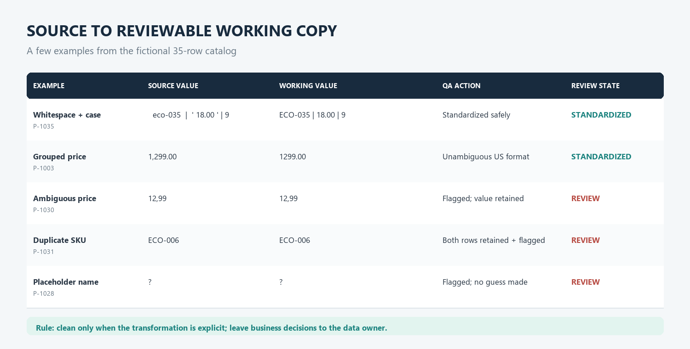
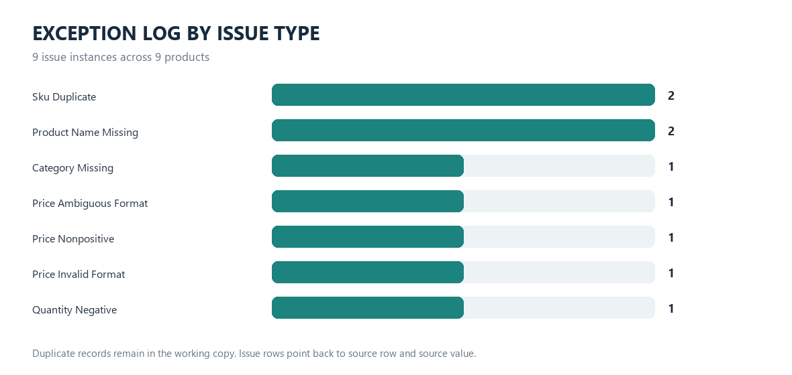

# Ecommerce Product Data QA

A synthetic portfolio demonstration of a done-for-you product catalog quality check before an ecommerce migration handoff. It shows how agreed rules can be applied to a source export, safe transformations can be made in a separate working copy, and unresolved issues can be returned in a traceable exceptions log.

> **Sample only:** all 35 catalog records are fictional. This repository does not contain client or employer data, and the demonstration is not evidence of completed client work.

## Sample result

The included 35-record CSV produces **9 distinct rows needing owner review** and **9 issue instances**:

| Issue | Instances |
| --- | ---: |
| Duplicate SKU (both affected records retained and flagged) | 2 |
| Missing or placeholder product name | 2 |
| Missing category | 1 |
| Ambiguous price format | 1 |
| Invalid price format | 1 |
| Nonpositive price | 1 |
| Negative quantity | 1 |
| **Total issue instances** | **9** |

The 9 issue instances occur on 9 different source rows in this sample. Duplicate SKUs are counted once on each affected row; records are never silently removed.

## Done-for-you workflow shown

1. Agree the required columns, accepted formats, currency assumptions, and business rules with the data owner.
2. Preserve the original export and run the checks against a working copy.
3. Apply only explicit, low-risk normalization such as trimming surrounding whitespace, normalizing SKU/currency/status casing, and formatting unambiguous prices and whole-number quantities.
4. Return a cleaned working CSV and a row-level exceptions CSV that records the source row, field, original value, action taken, and review note.
5. Hand flagged decisions back to the data owner for resolution and approval before any migration or import.

In this code sample, the pipeline generates the two CSV deliverables in `output/`. A real engagement would also include a concise handoff summary tailored to the agreed scope. This project does not connect to a store or perform a migration.

## Preview





## Validation scope

The current rules:

- Require an exact CSV header: `product_id`, `sku`, `product_name`, `category`, `unit_price`, `currency`, `quantity`, and `status`.
- Trim surrounding whitespace; uppercase SKU and currency; lowercase status.
- Flag missing or duplicate SKUs, blank or placeholder names, and blank categories.
- Accept positive plain decimal prices and unambiguous US thousands separators, standardize accepted values to two decimal places, and accept a `$` prefix only for USD.
- Flag missing, ambiguous, malformed, nonpositive, or currency-conflicting prices.
- Standardize whole-number quantities and flag missing, malformed, or negative quantities.
- Flag non-empty currencies other than USD for review; no currency conversion is performed.
- Preserve the source CSV and retain flagged values in the working copy when a safe correction cannot be made.

The `qa_status` value `ready_for_review` means no configured check flagged that row. It is not a guarantee that the row is approved or ready to import.

## Limitations

This is a small, rule-based demonstration, not a production migration tool. It does not infer missing business values, decide SKU ownership, deduplicate records, map fields between platforms, check image assets, verify product ID uniqueness, validate status values against an allowed list, convert currencies, connect to Shopify or another store, import data, or approve business decisions. A blank currency code is not flagged by the current rules. Price parsing is intentionally limited to the documented formats, and quantity is treated as a whole number. Real work requires owner-approved rules, representative files, and review of exceptions before use.

## Run locally

Requires Python 3.10 or newer. The pipeline and tests use only the Python standard library.

From this project folder:

```powershell
python -m src.qa_pipeline
python -m unittest discover -s tests -v
```

The pipeline reads `data/products_source.csv` and writes:

- `output/products_cleaned_working.csv`
- `output/exceptions_issue_log.csv`

It leaves the source file unchanged. The test suite runs in a temporary folder.

## Project files

```text
02-ecommerce-product-data-qa/
├── README.md
├── data/
│   └── products_source.csv
├── images/
│   ├── before_after_comparison.png
│   └── exception_breakdown.png
├── src/
│   └── qa_pipeline.py
└── tests/
    └── test_qa_pipeline.py
```
